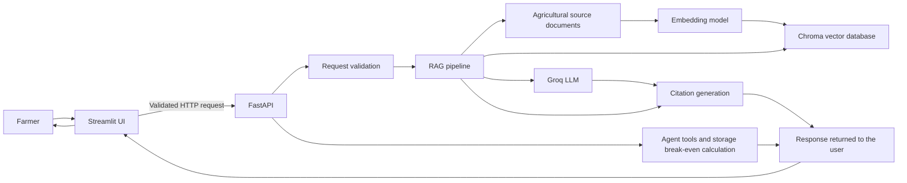
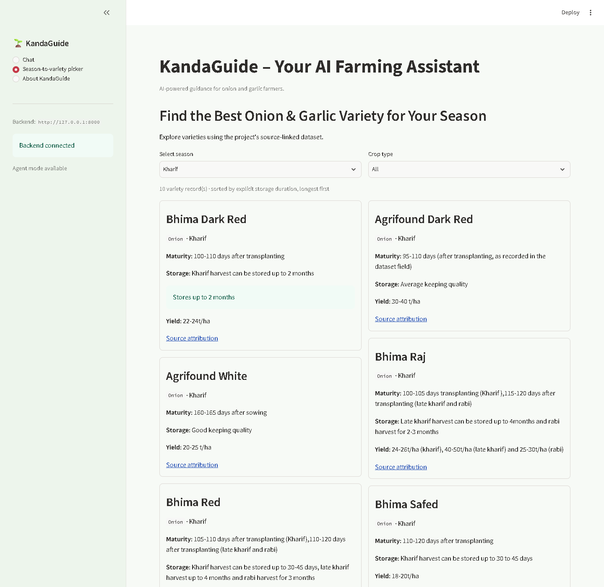

# KandaGuide – AI-Powered Onion & Garlic Farming Assistant

[](https://github.com/sumitshinde2006/Gen-Ai-Training/actions/workflows/ci.yml)

**Student Name:** Sumit Gorakshanath Shinde  
**Student ID:** 2124UDSM2018  
**Department:** CSE (Data Science)  
**Project ID:** SJ-09 – Agriculture

## CI and deployment status

| Project tracker item | Verified status |
|---|---|
| PR #1 (`feature/ci-cd-deployment`) | **Merged** on 21 November 2026; merge commit `aa4b9a992a1ca61396c4c1be2c9e3cb52660a`. |
| CI workflow | **Passed** on merge commit: Ruff, Pytest, and Docker build jobs completed successfully. |
| Render deployment | Render Blueprint configuration exists in `render.yaml`; live deployment is not yet verified. |
| API health URL | No verified public URL available; HTTP 200 has not been confirmed. |
| Streamlit UI URL | No verified public URL available. |

### GitHub Actions

The [CI workflow](https://github.com/sumitshinde2006/Gen-Ai-Training/actions/workflows/ci.yml)
runs three independent checks: `ruff check .`, `python -m pytest -v` with
project and development dependencies, and a Docker Buildx image build from the
root `Dockerfile`. Tests run with empty Groq and Gemini keys; provider calls in
the test suite are mocked, and embedding tests use deterministic fixtures so
CI does not need paid LLM credentials or external model downloads.

The badge links to the actual repository workflow at
`.github/workflows/ci.yml`. GitHub API verification found PR #1 closed and
merged, with its merge commit workflow run concluding `success`. Later main
branch runs also concluded `success`.

### Render deployment

`render.yaml` defines two Docker web services using the existing root
`Dockerfile`: a FastAPI API service with `/health` checking and persistent
storage for Chroma/model cache, and a Streamlit UI service. The UI receives the
API service's internal Render `hostport` reference, normalized to HTTP; it does
not connect to `localhost`. The UI already displays backend health and uses the
existing season picker, RAG chat, and citation rendering.

Render is the configured deployment platform. The service definitions match
the checked-in application: the API command starts `app.main:app`, the UI
command starts `ui/app.py`, both use the root Dockerfile and Render's `PORT`,
and the API health check targets the application's `/health` route. The UI
uses the API service's internal `hostport` reference. This confirms the
Blueprint matches the repository configuration; it does not confirm what is
currently deployed in Render.

The available repository and environment did not provide Render service
details, so the live URLs and public reachability could not be verified. No
API HTTP 200 check was completed. Do not treat either service as verified live
until its actual Render URL is recorded and checked.

| Service | Verified URL / status |
|---|---|
| Streamlit application | Not verified; actual Render service URL unavailable |
| FastAPI API | Not verified; actual Render service URL unavailable |
| FastAPI `/health` | Not checked; no verified public API URL is available |

To configure the Render Blueprint:

1. In the Render Dashboard, create a **Blueprint** from this repository and
   review `render.yaml`. The API uses the Standard plan and a 1 GB persistent
   disk; confirm the current cost and plan availability before creating it.
   The UI uses the Free plan and may sleep when idle.
2. Set `GROQ_API_KEY` in the API service's Render environment dashboard. The
   Blueprint marks it `sync: false`, so the key is not stored in Git. Keep
   `LLM_PROVIDER=groq`; optionally set `LLM_MODEL`. For Gemini, set
   `LLM_PROVIDER=gemini` and provide `GEMINI_API_KEY` in the dashboard instead.
3. After the API service is running, open its Render Shell and run
   `python -m app.vectorstore` once to build the document index. This downloads
   the configured sentence-transformer model and indexes `data/raw/`; allow
   network access and enough time for the first run. The API disk stores
   Chroma under `/var/data/chroma` and the model cache under
   `/var/data/huggingface`. Re-run indexing after changing source documents.
4. Confirm the API's public `/health` returns HTTP 200 with a JSON body, open
   the Streamlit URL, and verify its sidebar reports **Backend connected**.
   Then check the season-to-variety picker, a Groq-backed chat, and returned
   citations before recording the verified URLs above.

Render provides `PORT` at runtime; both service commands bind to `0.0.0.0`
and use that port. The required runtime settings are:

| Service | Variable | Configuration |
|---|---|---|
| API | `GROQ_API_KEY` | Required for model-backed chat; set as a Render secret |
| API | `GEMINI_API_KEY` | Alternative secret when `LLM_PROVIDER=gemini` |
| API | `LLM_PROVIDER` | `groq` (Blueprint default); use `gemini` only with its key |
| API | `LLM_MODEL` | Optional provider-supported model override |
| API | `KANDAGUIDE_CHROMA_PATH` | `/var/data/chroma` on the persistent API disk |
| API | `HF_HOME` | `/var/data/huggingface` on the persistent API disk |
| UI | `API_BASE_URL` | Render internal service reference supplied by the Blueprint |
| UI | `FEEDBACK_DB_PATH` | `/tmp/feedback.sqlite` |
| UI | `STREAMLIT_SERVER_HEADLESS` | `true` (Blueprint setting) |
| Both | `PORT` | Supplied by Render; do not hard-code it in the dashboard |

The API's persistent disk is required to retain the Chroma index and model
cache across restarts. Other container filesystem locations are temporary:
the UI feedback database at `/tmp/feedback.sqlite` can be lost on restart or
redeploy. Do not use the Free plan for the API if durable Chroma storage is
required. Current public service status remains unverified because the Render
service URLs and deployment state were not available for this check.

#### Render troubleshooting

- **API stays unhealthy:** Check the API logs for startup errors and verify
  that the service command binds to `0.0.0.0:$PORT`; inspect `/health` before
  troubleshooting model configuration.
- **Chat has no indexed sources:** In the API service Shell, run
  `python -m app.vectorstore` and confirm the Chroma path is on the mounted
  disk. Health and variety records can work before indexing; RAG chat needs it.
- **UI says the backend is unavailable:** Confirm both services are running
  and that the UI's `API_BASE_URL` is sourced from the API service reference,
  not `localhost`; inspect the API health response and UI logs.
- **Chat cannot call Groq:** Set or rotate `GROQ_API_KEY` in the Render
  dashboard, confirm `LLM_PROVIDER=groq`, and redeploy/restart the API. Never
  put the key in `render.yaml`, the Dockerfile, or a committed environment file.
- **Index or feedback data disappeared:** Chroma and model cache must remain
  under `/var/data` on the API's mounted disk. The UI feedback database is
  intentionally temporary unless a separate persistent-storage design is added.

## 1. Product

KandaGuide is an AI-powered agricultural information assistant designed
to help onion and garlic farmers find reliable information about crop
varieties, growing seasons, maturity periods, yield, storage and cultivation.

The project aims to develop a searchable agricultural knowledge base
and eventually an AI assistant using RAG and Agentic AI.

## 8. Agentic AI milestone

KandaGuide now includes a deterministic `storage_break_even` tool, an
independent hand-written agent loop, and a LangGraph workflow with
thread-scoped memory and an interrupt/resume approval step for storage
recommendations. The agents reuse the existing `app.rag.answer_question()`
retrieval and LLM pipeline. See [docs/agentic-ai.md](docs/agentic-ai.md) for
the workflow, memory limitations, source review, and implementation details.

### Storage break-even tool

For quantity `Q`, today's price `P`, and loss fraction `L`, the gross-revenue
break-even price is:

```text
today's revenue = Q × P
saleable quantity = Q × (1 − L)
break-even price per quintal = today's revenue ÷ saleable quantity
```

An explicit loss percentage is used exactly. If omitted, the tool returns
both 30% and 40% loss scenarios and labels the range unverified. The local
MANAGE reference associates 30–40% with Fusarium basal rot; it does not
verify a general DOGR default. A local DOGR variety record reports 31.11%
after four months specifically for Bhima Prasanskaran. The output is a
gross-revenue calculation, not full profit; storage months do not imply a
time-based loss rate.

### Install and run

```powershell
python -m pip install -r requirements.txt
uvicorn app.main:app --reload
```

### `POST /agent`

Request a calculation:

```json
{
  "message": "I have 100 quintals of onion. Today's price is 2000 per quintal. Calculate the break-even price for 3 months with 30% storage loss.",
  "thread_id": "farmer-session-001",
  "approval": null
}
```

The response includes `status`, `answer`, `tools_used`, `citations`,
`calculation_result`, `requires_approval`, and `follow_up`. Calculation
results are marked as calculated results; agricultural claims come from RAG
and include citations.

For a storage decision request, the graph pauses and returns
`status: "awaiting_approval"`, the proposed `calculation_result`, and
`requires_approval: true`. Resume the same thread to approve:

```json
{
  "message": "Review the proposed storage decision",
  "thread_id": "farmer-session-001",
  "approval": "approved"
}
```

Or reject with `"approval": "rejected"`. Approval accepts only the proposed
decision response; no sale, order, buyer contact, or external transaction is
performed. The local in-memory checkpointer loses state when the server
restarts and is not shared across worker processes. A production deployment
should use persistent checkpoint storage and authenticate thread access.

### Tests

```powershell
python -m unittest test_agentic_ai test_graph_agent
python -m unittest discover -p "test_*.py"
```

## 2. Target Users

- Onion and garlic farmers
- Small and marginal farmers
- Farmer Producer Organizations (FPOs)
- Agricultural students
- Agricultural extension officers

## Problem statement

Onion and garlic farmers need reliable answers about varieties, seasons,
planting practices, maturity, yield, harvesting, and storage. Relevant
information is dispersed across agricultural websites and technical PDFs,
including region-specific details that can be difficult to compare. Farmers
also need to distinguish source-supported guidance from live facts that are
not present in the available documents.

## Solution

KandaGuide is a source-grounded agricultural assistant implemented with
FastAPI, Streamlit, Chroma, a sentence-transformer embedding model, and a Groq
LLM. The RAG workflow ingests the checked-in DOGR and MANAGE documents,
chunks and embeds their text, retrieves semantically similar passages, grounds
the model response in retrieved evidence, and returns citations to the
underlying title, source, page, and chunk ID. The application also implements
record search, season filtering, and an agent workflow that performs
deterministic storage break-even calculations with explicit approval.

## Architecture diagram



## 5. Data sources and limitations

The project uses information from official agricultural institutions.

### ICAR-DOGR
Onion and garlic varieties developed:
https://www.dogr.res.in/index.php/research/varieties-developed?layout=edit

### DOGR Garlic Information
https://dogr.res.in/index.php/component/content/article/garlicagropedia?layout=edit

### MANAGE
Good Agricultural Practices in Onion and Garlic:
https://www.manage.gov.in/publications/eBooks/Good%20Agricultural%20Practices%20in%20Onion%20and%20Garlic.pdf

### ICAR
Improved Onion Varieties Released:
https://icar.org.in/node/2087

All variety-specific values are linked to their sources.
Unknown values are stored as null rather than guessed.
The available documents do not provide live mandi prices, current weather,
current government-scheme status, or individual field and market conditions.
Data should be treated as source-specific reference information, not
personalized or real-time advice.

## 6. Technology Stack

- Python
- FastAPI
- Pandas
- BeautifulSoup
- Requests
- Scikit-learn
- TF-IDF
- Cosine Similarity
- JSON
- Git and GitHub

## 7. Project Structure

```text
KandaGuide/
│
├── README.md
├── requirements.txt
├── .gitignore
│
├── data/
│   ├── raw/
│   └── records.json
│
├── app/
│   ├── fetch.py
│   ├── ingest.py
│   ├── models.py
│   ├── records.py
│   ├── main.py
│   └── smart_search.py
│
└── analysis/
    └── explore.py
```
## 8. How to Run

### 1. Activate the virtual environment

**Windows PowerShell:**

```powershell
myenv\Scripts\activate
```

### 2. Install dependencies

```bash
pip install -r requirements.txt
```

### 3. Download agricultural documents

```bash
python -m app.fetch
```

### 4. Process agricultural data

```bash
python -m app.ingest
```

This generates the cleaned agricultural dataset in `data/records.json`.

### 5. Run data analysis

```bash
python -m analysis.explore
```

### 6. Start FastAPI

```bash
uvicorn app.main:app --reload
```

### 7. Open API documentation

http://127.0.0.1:8000/docs

### 8. Test the API

- `GET /health` – Check API status.
- `GET /records` – Retrieve agricultural records.
- `GET /records/1` – Retrieve a specific variety.
- `GET /search?q=Bhima` – Search agricultural varieties.
- `POST /questions` – Submit a farming question.
- `POST /chat` – Generate an evidence-grounded answer using retrieved
  variety records and a configured Groq or Gemini provider.

`POST /questions` remains an acknowledgement endpoint for compatibility.
See [LLM integration](docs/llm-integration.md) for provider setup and
`POST /chat` details.

## Checkpoint 1

- Checkpoint 1 documentation and API smoke-test results are available in
  [`docs/checkpoint-1.md`](docs/checkpoint-1.md).
- Learn how LLMs and RAG could fit KandaGuide in
  [`docs/how_llms_work.md`](docs/how_llms_work.md).
- The FastAPI run steps above use the existing `myenv` environment and
  `uvicorn app.main:app --reload` command.

## 9. API Endpoints

| Method | Endpoint | Purpose |
|---|---|---|
| GET | /health | Check API status |
| GET | /records | Get agricultural records |
| GET | /records/{id} | Get one variety |
| GET | /search?q=Bhima | Search varieties |
| POST | /questions | Submit a farming question |
| POST | /chat | Ask a source-grounded agricultural question |
| POST | /ask | Ask over indexed source documents and receive chunk citations |

## LLM integration (S1/S2)

KandaGuide can use Groq or Google Gemini without application-code changes.
Install dependencies and prepare a local environment file:

```powershell
.\myenv\Scripts\python.exe -m pip install -r requirements.txt
if (-not (Test-Path .env)) { Copy-Item .env.example .env }
```

If `.env` already exists, keep it and edit it without overwriting it.
Set `LLM_PROVIDER=groq` and `GROQ_API_KEY`, or use
`LLM_PROVIDER=gemini` and `GEMINI_API_KEY`. Optionally set `LLM_MODEL` to a
model ID supported by the selected provider; when blank, the documented
provider default is used. Never commit `.env`; `.env.example` has empty
credential fields.

Run FastAPI from the repository root:

```powershell
.\myenv\Scripts\python.exe -m uvicorn app.main:app --reload
```

Example request:

```json
{"question": "Which onion varieties have good storage life?"}
```

Example response:

```json
{
  "answer": "Answer based on retrieved agricultural records, with source URLs.",
  "confidence": "medium",
  "follow_up": "Would you like to compare Rabi onion varieties?"
}
```

The exact answer depends on retrieved records. If information is unavailable,
KandaGuide states that limitation instead of filling the gap. Prompt V1 is
the default; V1/V2 evaluation status is documented in
[`eval/prompt_compare.md`](eval/prompt_compare.md). See
[`docs/llm-integration.md`](docs/llm-integration.md) for model IDs, provider
architecture, setup, and error behavior.

## Semantic document search (S1/S2)

KandaGuide also supports persistent semantic search over the HTML and PDF
documents in `data/raw/`. Install the added dependencies and build the local
index:

```powershell
.\myenv\Scripts\python.exe -m pip install -r requirements.txt
.\myenv\Scripts\python.exe -m app.vectorstore
```

The index command extracts and chunks the documents, generates
`sentence-transformers/all-MiniLM-L6-v2` embeddings, and stores them in the
`kandaguide_knowledge` Chroma collection under `data/chroma/`. The first
embedding run may download the model. The MANAGE `.txt` sidecar is skipped
when its original PDF is available, avoiding duplicate chunks and retaining
PDF page numbers.

Start FastAPI as shown above and query the separate semantic endpoint:

```text
GET http://127.0.0.1:8000/search/semantic?q=Which%20onion%20varieties%20have%20good%20storage%20life%3F&top_k=5
```

The existing `GET /search` remains a TF-IDF search over variety records.
Semantic-search setup, provenance, persistence, and evaluation are described
in [`docs/semantic-search.md`](docs/semantic-search.md) and
[`eval/search_results.md`](eval/search_results.md).

## 10. Development Progress

- Day 1: Project introduction and Python fundamentals.
- Day 2: Variety dataset and record operations.
- Day 3: Agricultural data ingestion pipeline.
- Day 4: FastAPI, Pandas and smart search.
- Checkpoint 1: LLM/RAG documentation and HTTP validation of the existing
  FastAPI endpoints.

## 11. Expected Outcome

KandaGuide aims to provide farmers with an accessible,
searchable and source-backed agricultural information assistant.

**Developed by Sumit Gorakshanath Shinde**  
Sanjivani University – SJ-09 Agriculture

## Evaluation results

The complete run used 15 evaluation questions with isolated temporary Chroma
indexes and the existing sentence-transformer model. Groq answer generation
completed for all 15 questions in both configurations.

| Metric | Config A (400/top-3) | Config B (600/top-5) |
|---|---:|---:|
| Retrieval hit rate | 84.62% | 100.0% |
| Answer correctness | 40.0% | 53.33% |
| Citation correctness | 26.67% | 26.67% |
| Grounded answers | 7.69% | 7.69% |
| Correct abstentions | 100.0% (2/2) | 100.0% (2/2) |
| Winner | - | **Configuration B selected** |

**Selection:** Configuration B won because it had the higher primary quality
score: 46.92%, compared with 43.59% for Configuration A. The primary score is
the unweighted mean of answer correctness, citation correctness, grounded
answer percentage, and correct-abstention percentage. Retrieval hit rate is
used only as a tie-breaker. These figures are keyword/citation proxies, not
semantic ground truth.

Evaluation materials: [dataset](eval/eval_set.json), [runner](eval/run_eval.py), [Configuration A results](eval/results_config_a.json), [Configuration B results](eval/results_config_b.json), and [summary](eval/evaluation_summary.md). Answer correctness uses at least 60% expected-keyword coverage as a transparent proxy, not objective ground truth. Citation correctness checks cited chunk IDs, source matches, and expected sources. Groundedness also checks expected-keyword coverage in retrieved context. See the summary for full scoring and winner criteria.

To repeat the Groq evaluation in PowerShell (with `GROQ_API_KEY` configured):

```powershell
$env:LLM_PROVIDER = "groq"
.\myenv\Scripts\python.exe eval/run_eval.py
```

The evaluator refuses to switch providers. Offline scoring tests use mocks and do not make paid calls:

```powershell
.\myenv\Scripts\python.exe -m unittest eval.test_run_eval
```

## Checkpoint 2 — Streamlit farming assistant

KandaGuide includes a Streamlit frontend connected to the existing FastAPI
backend. The sidebar provides Chat, Season-to-variety picker, and About pages,
and reports backend health. Chat supports the source-grounded `/ask` RAG route
and the existing `/agent` workflow when its route is available. Messages and
citations remain visible for the current Streamlit session.

The picker reads `data/records.json` directly. It filters the verified season
labels (including records suitable for multiple seasons), supports onion and
garlic filters, and sorts explicit numeric storage durations before records
without comparable month values. Maturity text is shown with the original
planting, sowing, or transplanting wording. Only explicit numeric storage
durations receive a “Stores up to N months” badge; qualitative keeping-quality
descriptions and loss-study intervals are not converted to durations. Each
variety card links to its recorded source URL.

Assistant feedback is stored locally in `data/feedback.sqlite`. Each response
can receive one thumbs-up or thumbs-down vote with an optional comment. The
database does not store API credentials. `.env` is ignored by Git; start from
`.env.example` to configure local settings.

### Install and run

From the project root, install dependencies (including Streamlit):

```powershell
python -m pip install -r requirements.txt
```

Set `API_BASE_URL` to the FastAPI base URL when it differs from the default
`http://127.0.0.1:8000`. For model-backed chat, configure the existing provider
variables described in [LLM integration](docs/llm-integration.md). Start the
backend and frontend in separate terminals:

```powershell
python -m uvicorn app.main:app --reload
```

```powershell
python -m streamlit run ui/app.py
```

The backend routes used by the frontend are:

| Method | Route | Request body | Frontend use |
|---|---|---|---|
| GET | `/health` | — | Backend connection status |
| GET | `/openapi.json` | — | Detect whether `/agent` is available |
| POST | `/ask` | `{"question": "..."}` | RAG answer and citations (`answer`, `citations`, `confidence`, `follow_up`) |
| POST | `/agent` | `{"message": "...", "thread_id": "...", "approval": null}` | Agent answer, citations, tools, and workflow status |

The frontend does not synthesize citations: it displays citations returned by
the backend and clearly marks answers without returned sources. Backend
timeouts, unavailable routes, and invalid response bodies produce an error
message while preserving the chat history. Agent mode is offered when the API
schema advertises `/agent`; runtime errors from unavailable agent dependencies
are reported in chat.

### Checkpoint 2 demo screenshot

The screenshot below is captured from the running Streamlit application:

### Demo video

**Demo video: placeholder for a future verified recording.** No genuine video
URL is currently available in the repository.



## Run with Docker

### Prerequisites

- Docker Desktop with Docker Compose.
- A Groq API key for model-backed `/chat`, `/ask`, and RAG-powered agent answers. Health, records, variety search, and the deterministic storage calculation can run without an LLM key.

### Clone and configure

Clone the repository and open a terminal in the project root:

```powershell
git clone <repository-url>
cd <repository-directory>
Copy-Item .env.example .env
```

Edit `.env` and set `GROQ_API_KEY` to your key. `LLM_PROVIDER` defaults to `groq`; set it to `gemini` and provide `GEMINI_API_KEY` if you use Gemini. Keep `.env` local; it is ignored by Git and is never copied into the image. Docker Compose reads these values from `.env` and passes them to the API container at runtime.

### Build and start both services

```powershell
docker compose up --build
```

Compose builds the shared Python image, starts the FastAPI service, waits for its `/health` check, and then starts Streamlit. Open:

- Streamlit: <http://localhost:8501>
- FastAPI: <http://localhost:8000>
- Swagger: <http://localhost:8000/docs>

The Streamlit container connects to FastAPI at `http://api:8000` over the Compose network. If you want semantic `/ask` answers, create the document index once after startup:

```powershell
docker compose exec api python -m app.vectorstore
```

The Chroma index is stored in the named `chroma_data` volume and remains available across container rebuilds and restarts. Streamlit feedback is stored separately in `feedback_data`. `docker compose down` stops and removes containers but keeps both named volumes. To remove the stored indexes and feedback too, run `docker compose down --volumes`.

### Stop or rebuild

```powershell
docker compose down
docker compose up --build
```

The second command rebuilds the image and starts both services again after code or dependency changes.

### Troubleshooting

- **Port already in use:** Change the host side of the `ports` mapping in `docker-compose.yml` (for example, `8502:8501`), then use the new host port in your browser.
- **Missing API key:** Records, search, health, and deterministic calculations still work. Set `GROQ_API_KEY` in `.env` (or select Gemini and set `GEMINI_API_KEY`) to enable model-backed responses, then restart with `docker compose up -d`.
- **API health check failing:** Inspect `docker compose logs api`. Check that the image built successfully and that port 8000 is available inside the container.
- **UI cannot connect to backend:** Keep `API_BASE_URL=http://api:8000` for the UI service. `localhost` inside the UI container points back to the UI container itself.
- **Docker image build errors:** Check Docker Desktop is running and that the build has network access to download Python packages and the embedding model. Retry with `docker compose build --no-cache` for a clean rebuild.

## Production notes

### Request limits, cache, and token reporting

`/ask` and `/agent` emit one structured JSON log record per request with the
endpoint, request ID, total latency in milliseconds, HTTP status, cache-hit
flag, and token usage. The middleware does not log prompts, answers, API keys,
or other request data. Groq prompt and completion counts are taken from the
provider's `usage` metadata when present; missing counts are logged as
unavailable (`null`), not estimated. Gemini usage metadata is also included
when the provider returns it.

The successful RAG response cache is process-local and bounded. Defaults are
60 seconds and 128 entries. Set `KANDAGUIDE_CACHE_TTL_SECONDS`,
`KANDAGUIDE_CACHE_MAX_ENTRIES`, or `KANDAGUIDE_CACHE_ENABLED=false` to adjust
or disable it. `app.rag.clear_response_cache()` clears the current process's
cache. It is not a distributed cache: each worker has its own entries, and all
entries are lost when that process restarts. Failed retrieval/generation
responses are not cached.

`KANDAGUIDE_MAX_QUESTION_LENGTH` defaults to 1000 characters and cannot exceed
1000; `KANDAGUIDE_MAX_TOP_K` defaults to 20 and cannot exceed 20. Empty
questions and invalid limits return validation errors. The values in
`.env.example` show the defaults.

### Local mocked benchmark

The following measurement used the repeatable benchmark script, with 100
sequential `POST /ask` calls through FastAPI's in-process `TestClient`:

| Metric | Measured result |
|---|---:|
| Average request latency | 3.267 ms |
| Median request latency (p50) | 3.244 ms |
| p95 request latency | 3.889 ms |
| Average prompt tokens per request | Not measured |
| Average completion tokens per request | Not measured |
| Cache hit rate | 99% (99/100 requests) |
| Cache TTL / maximum entries | 60 seconds / 128 |
| Maximum accepted question / top-k | 1000 characters / 20 |

Test conditions: Python 3.11.7 on Windows
(`Windows-10-10.0.26300-SP0` as reported by Python), AMD64
(`AMD64 Family 25 Model 68 Stepping 1, AuthenticAMD`), 12 logical CPUs.
Retrieval and LLM output were mocked; the first request missed the cache and
the other 99 requests repeated the same question. The latency includes local
FastAPI/TestClient processing, but excludes network, embedding, vector-store,
and provider latency. No real API requests were made. Token averages are
unavailable because the mock has no provider usage metadata; no token
estimates are presented. These results are a small local benchmark, not a
production load test and can vary by machine and run.

Repeat the measurement from the repository root with:

```powershell
.\myenv\Scripts\python.exe -m scripts.benchmark_api --requests 100
```

### Security and test coverage

The automated prompt-injection test uses mocked retrieval and a mocked LLM
response. It passes a malicious request and retrieved text through the RAG
prompt construction, checks that retrieved text is explicitly treated as
untrusted evidence, and verifies the mocked assistant abstains without
citations or disclosure. This is a focused regression test, not a guarantee
against all prompt-injection techniques or a test of live model behavior.
Provider credentials are not included in logs. The API does not add
authentication or authorization; deployments exposed to untrusted clients
should be protected at the service or gateway layer.
