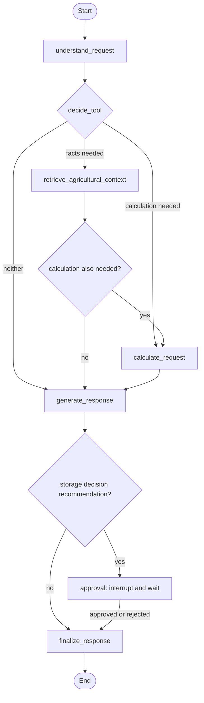

# KandaGuide: Agentic AI, tools, and LangGraph

## What an agent adds to RAG

An AI agent chooses an available capability to move a request forward. RAG retrieves relevant agricultural document passages and asks the existing LLM wrapper to answer only from those passages. An agent decides whether a request needs that evidence search, a deterministic calculation, or both. KandaGuide needs a calculation tool because arithmetic should be reproducible and should not depend on an LLM's generated numbers.

The existing evidence path is `app.rag.answer_question()`, which uses the persistent Chroma index, existing provider wrapper, and citations from retrieved chunks. Neither agent reimplements that RAG pipeline.

## `storage_break_even`

`app.tools.storage_break_even()` uses Decimal arithmetic. For quantity `Q`, today's price `P`, and loss fraction `L`:

```text
today's gross revenue = Q × P
saleable quantity = Q × (1 − L)
break-even price per quintal = today's gross revenue ÷ saleable quantity
                           = P ÷ (1 − L)
```

An explicitly supplied percentage is used as-is. The hand-written agent can also use the project record's 31.11% value when the request names Bhima Prasanskaran and the recorded four-month duration; it returns that citation and does not extrapolate it to other durations. With no percentage or matching variety record, the tool returns two separate scenarios at 30% and 40%; it never substitutes a midpoint. The scenario range is marked `unverified_range` and carries its provenance in the result. This is deliberate: the local source records do not support 30–40% as a general DOGR default. The MANAGE reference in `data/raw/manage_reference.txt`, Fusarium basal rot section, attributes 30–40% storage loss to bulbs affected by that disease. The local DOGR variety page `data/raw/dogr_varieties.html` says Bhima Prasanskaran exhibits 31.11% storage losses after four months. Those scoped claims do not establish a general default for all onions, varieties, or storage conditions.

For 100 quintals at ₹2,000 per quintal, gross revenue today is ₹200,000. At 30% loss, 70 quintals remain and the break-even price is ₹2,857.14/quintal. At 40% loss, 60 quintals remain and the price is ₹3,333.33/quintal. These are gross-revenue comparisons; storage, transport, interest, inflation, quality discounts, and other costs are excluded. Months are informational only and do not change the loss rate.

## Structured request planner

`app.agent_planner.plan_agent_request()` returns a constrained JSON plan that
classifies a request as calculation, agricultural knowledge, mixed, or
clarification. Unambiguous common calculations use a local fast path; ambiguous
wording is sent to the configured model with `prompts/agent_planner.txt`. The
model extracts intent and directly stated values only—it must not calculate,
invent missing values, or provide chain-of-thought. Extracted numbers are
checked against the current request before execution.

The graph dispatches plans to deterministic Decimal tools for profit, revenue,
break-even, storage loss, cost totals, percentages, price comparisons, and basic
arithmetic. Agricultural questions use `answer_question()` and its citations;
mixed plans call both. Follow-ups are generated from each operation's required
inputs. For example, profit needs quantity, sale prices, and expenses, but does
not require storage months or storage-loss percentages.

`app.agent_loop.run_agent()` uses the same planner and deterministic execution
functions for non-graph callers. Unit tests mock model-planner responses, so
they require no paid API calls.

## LangGraph workflow and memory

`app.graph` represents the work as `understand_request`, `decide_tool`,
`retrieve_agricultural_context`, `calculate_request`, `generate_response`,
`approval`, and `finalize_response` nodes. Conditional edges skip capabilities
the request does not need. Each request resets its prior answer, citations, and
tool outputs. A per-thread checkpointer stores messages and workflow state;
prior numeric values are supplied to planning only when the user explicitly
refers to them, and only the referenced fields are reused.

The graph uses LangGraph's local `MemorySaver` checkpointer. It persists only for the lifetime of the Python process, is not shared between workers, and is cleared on restart. For durable deployments, configure a persistent LangGraph checkpointer such as PostgreSQL and add authentication/authorization around thread IDs. The current API has no user identity layer, so a thread ID is a conversation key, not an access-control credential.

## Human approval

The deterministic calculation may run before approval. If a user asks for a storage decision or recommendation (for example, whether they should store), the graph displays the proposed inputs and calculation result through a LangGraph `interrupt()` and pauses. Resume it by sending `approval: "approved"` or `"rejected"` to `/agent` with the same thread ID. Rejection returns a rejected state. The workflow does not sell crops, place orders, contact buyers, or perform other external actions.

## Custom loop vs. LangGraph

The custom agent is small and easier to inspect; callers manage history and there is no execution checkpoint or interrupt/resume feature. The LangGraph version formalizes the same routing as nodes and edges, stores state by thread, and supports a real approval pause. Both reuse the same calculation and RAG implementations.

## Run and test

```powershell
python -m pip install -r requirements.txt
python -m unittest test_agentic_ai test_graph_agent
python -m unittest discover -p "test_*.py"
```

The graph tests are skipped if LangGraph has not been installed. The application can run its earlier endpoints without importing LangGraph; `/agent` returns HTTP 503 until the dependency is available.

## Workflow diagram


