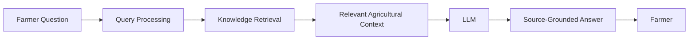

# How LLMs Work — KandaGuide

## From AI to large language models

**Artificial Intelligence (AI)** is the broad field of building computer
systems that perform tasks people associate with intelligence, such as
recognizing patterns, understanding language, or making predictions.

**Machine Learning (ML)** is one way to build AI. Instead of writing a
separate rule for every situation, developers train a model on examples so
it can learn patterns and use them on new inputs.

**Deep Learning** is a kind of machine learning that uses neural networks
with many processing layers. It is useful for learning complex patterns in
large amounts of text, images, audio, and other data.

A **Large Language Model (LLM)** is a deep-learning model trained on a large
collection of text. It learns statistical patterns in language and can
generate or transform text in response to an input. An LLM does not
automatically know whether a generated statement is true.

## How an LLM works

At a high level, training adjusts a model's internal numerical values so
that it becomes better at predicting the next token in text. When the model
is used, it processes the supplied input and repeatedly predicts a likely
next token to create a response. The result depends on the model, its
training, the prompt, any supplied context, and generation settings.

### Tokens

Tokens are the units of text a language model processes. A token can be a
whole short word, part of a longer word, punctuation, or another text
fragment. The exact tokenization depends on the model. Input and output
limits are measured in tokens rather than simply in words.

### Embeddings

An embedding is a list of numbers representing an item such as a word,
sentence, or document. Learned embeddings can place items with related
meanings near each other in a vector space. Search systems can compare
vectors to find potentially related text. KandaGuide's current
`smart_search()` uses TF-IDF vectors, not learned neural embeddings.

### Transformers and attention

A **transformer** is a neural-network design used by many modern LLMs. It
processes tokens in relation to one another rather than treating each word
as an isolated item.

**Attention** is a transformer mechanism that helps the model weigh which
parts of the input are relevant while processing a token. For example, a
word's meaning can depend on other words in the sentence. Attention helps
the model use those relationships; it is not a guarantee that the model
understands a fact or will answer correctly.

### Prompts and context windows

A **prompt** is the input supplied to a model. It can include a question,
instructions, conversation history, and retrieved reference material.

The **context window** is the maximum amount of input and generated text a
model can handle together for one request. If relevant material is not
included in the prompt or does not fit, the model may not be able to use it.

### Hallucinations

A **hallucination** is a plausible-sounding response that is unsupported or
incorrect. Language models generate likely text; they are not automatically
fact-checkers. A farming assistant should avoid presenting an unsupported
answer as fact. If its available records cannot answer a question, it should
say that the information is unavailable instead of inventing a value or a
source.

### Temperature and model parameters

**Model parameters** are the learned numerical values inside a trained
model. They are different from request settings.

**Temperature** is a generation setting that affects how varied token
selection can be. Lower values generally make outputs more predictable;
higher values can make them more varied. Temperature does not add
knowledge, validate facts, or make a response more reliable.

## Retrieval-Augmented Generation (RAG)

**Retrieval-Augmented Generation (RAG)** is a design that searches a
knowledge collection for relevant material and gives that material to an
LLM as context for answering. A well-designed RAG system can show which
sources support its answer. Retrieval does not guarantee correctness: the
retrieved material and the generated response still need suitable checks.

An **LLM** is the language model that generates text. **RAG** is a way of
supplying retrieved information to a model; it is not itself a language
model. An LLM can be used without RAG, and a search system can retrieve
documents without an LLM.

### A planned KandaGuide workflow



In a future KandaGuide RAG implementation, a farmer's question could be
processed and used to retrieve relevant, source-backed onion and garlic
information. The retrieved passages and their source references could be
provided to an LLM to draft an answer. KandaGuide should return only what
the sources support, preserve source links, and clearly say when the
available data cannot answer a question. For example, the current dataset
does not contain live mandi prices, so the system must not invent today's
price.

**Current implementation status:** KandaGuide currently searches its
variety records using TF-IDF and cosine similarity. Its question endpoint
only acknowledges receipt. Complete LLM and RAG integration, including
source-grounded answer generation, is not implemented yet.

## How `smart_search()` works

The existing [`smart_search()`](../app/smart_search.py) function retrieves
variety records by comparing the query with text built from each record:

1. **Load records:** it calls `load_records()` from
   [`app/records.py`](../app/records.py), which reads `data/records.json`
   relative to the project working directory. If that file does not exist,
   `load_records()` returns an empty list.
2. **Create searchable text:** for each record, it joins available values
   from `variety_name`, `category`, `season`,
   `maturity_days_after_transplanting`, `maturity_note`, `yield_t_ha`, and
   `storage_life`. Missing or null values contribute empty text. The
   source URL is not part of this search text.
3. **Build TF-IDF vectors:** `TfidfVectorizer` learns word and two-word
   phrase (unigram and bigram) features from the records and query.
   TF-IDF gives weight to terms that are informative within this set of
   text, rather than treating every common term as equally useful.
4. **Compare with cosine similarity:** cosine similarity compares the
   query vector with each record vector. A larger score means the vectors
   point in a more similar direction; it is a text relevance score, not a
   measure of agricultural truth.
5. **Rank results:** the function orders records by descending score,
   skips records whose score is zero or lower, and returns at most
   `top_k` matching records. Each returned copy includes a rounded
   `similarity_score`.
6. **Help farmers find records:** this lets a farmer search for terms such
   as a variety name, season, maturity, yield, or storage and see matching
   records sooner. The result is a search shortlist, not a personalized
   recommendation or a generated answer.

Example using the existing function:

```python
from app.smart_search import smart_search

matches = smart_search("Bhima onion Rabi", top_k=3)
for record in matches:
    print(record["variety_name"], record["similarity_score"])
```

The matches depend on the records currently in `data/records.json`; this
example does not imply that search results are recommendations.

## Farmer-question examples and dataset coverage

No original six farmer questions were found in the repository's tracked
documentation or source files, and no matching question list was found in
the repository issue search. Therefore, the following are new examples;
Q1–Q6 are not presented as recovered project-card wording.

Here, **answerable** means the current searchable variety records contain
relevant data for the question. It does not mean the current API generates
a natural-language answer. `POST /questions` currently acknowledges
questions only. The repository also contains a MANAGE reference text, but
that material is not indexed by `smart_search()`.

| ID | Farmer question | Can the current searchable dataset answer it? |
|---|---|---|
| Q1 | Which onion varieties in the dataset are listed for the Rabi season? | **Yes.** The records include onion variety names and season values. |
| Q2 | Which garlic varieties are listed, and what yield and storage-life values does the dataset record for each? | **Yes.** The garlic records include yield and storage-life values. |
| Q3 | Which onion varieties are listed for the Kharif season? | **Yes.** The records include onion season values. |
| Q4 | What maturity period is recorded for Bhima Light Red onion? | **Yes.** The record includes a maturity value. |
| Q5 | What yield value is recorded for Bhima Light Red onion? | **Yes.** The record includes a yield value. |
| Q6 | What is today's onion mandi price per quintal in Lasalgaon? | **No.** The dataset does not contain live mandi prices. KandaGuide must say this information is unavailable and must not invent a price. |
| Q7 | What storage-life information is recorded for Bhima Kiran onion? | **Yes.** The record has a storage-life entry. |
| Q8 | Which cultivation practices for onion and garlic should I follow on my farm? | **No, not through the current searchable variety records.** The repository has a MANAGE reference text, but it is not indexed by `smart_search()` or served as a cultivation-practice answer. |
| Q9 | What region and season are recorded as recommended for Bhima Prasanskaran? | **Partly.** Recommendation text appears in that record's `storage_life` value rather than a dedicated recommendation field; it should be checked against its source before being presented as advice. |
| Q10 | Which onion variety should I choose for my field and local market? | **No.** The records are not a personalized recommendation service and do not contain the farmer's field conditions or live local-market information. |

These examples are intended to show both what the current records contain
and where a future retrieval system should explicitly report missing
information.
